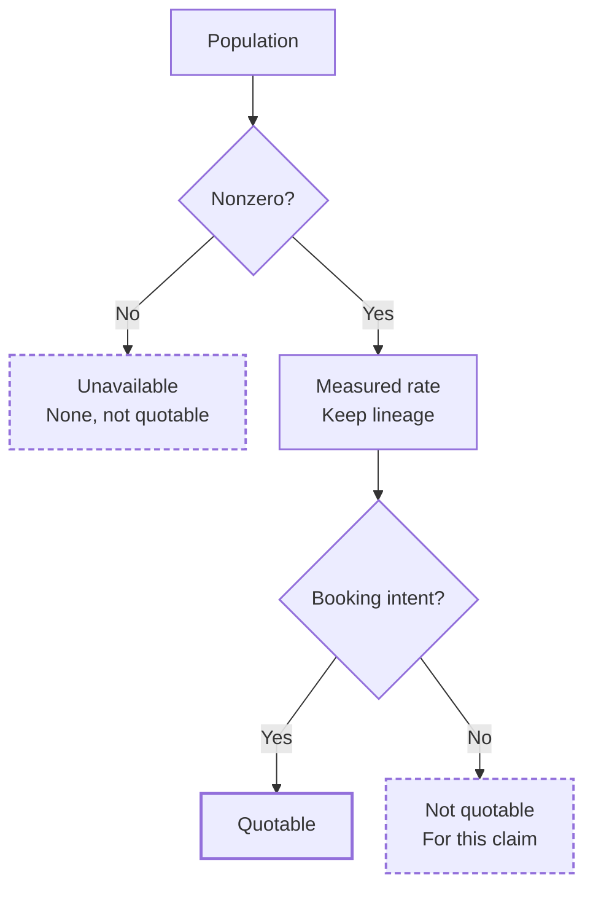

# Metric Integrity

I can make a booking rate look like **28.6%** or **11.8%** without changing a single booking.

No fraud required. Just change the denominator.

This little Python project came out of a recurring reporting problem: a percentage can be mathematically correct and still answer the wrong question. So I made the number carry its paperwork — population, calculation, evidence basis, and whether it's safe to quote for the claim you're making.

## Meet the tiny, suspicious dataset

There are **34 synthetic calls**. Fourteen callers wanted to book. Four booked.

| What somebody might say | Calculation | Can we quote it as *booking-intent success*? |
| --- | ---: | --- |
| "28.6% of people who wanted to book did" | 4 / 14 | Yes |
| "Our booking success rate is 11.8%" | 4 / 34 | No — that includes calls with no booking intent |
| "Those bookings were worth 4,800" | 4 × a configured 1,200 assumption | No — modelled, not collected revenue |
| "We recovered X in revenue" | No attribution join | No value available |

The arithmetic is not the problem. The sentence beside it is.

## Before anybody quotes the percentage

This is the decision behind the table: a rate has to carry the right population before it's usable for a particular claim.

Source to read: [rates](src/metric_integrity/rates.py), [valuation](src/metric_integrity/valuation.py), [report](src/metric_integrity/report.py), and [tests](tests/). The [verification notes](docs/verification.md) have the exact checks.

The rules are deliberately strict: a denominator of zero is unavailable; invalid value assumptions don't produce money-shaped guesses; and a "measured" basis doesn't automatically mean the result is quotable for every claim.

These are **synthetic examples**, not a client's actual calls, revenue, or outcomes. That's the whole point of including the evidence labels.
